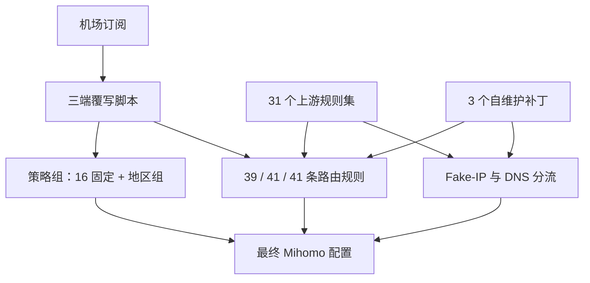
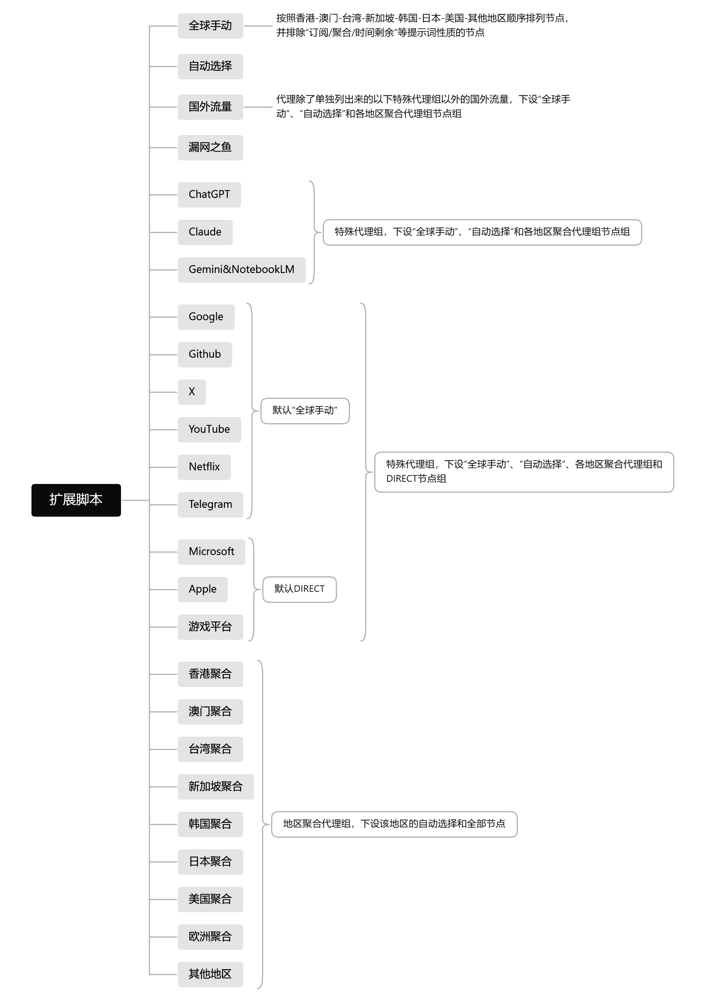

<div align="center">

# Mihomo RouteKit

**为 Clash Verge Rev、Bettbox 与 FlClash 提供一套可迁移、可控、面向 Mihomo 的统一分流脚本。**

**换机场，不换代理组，不换分流习惯。**

[](./Clash-Verge-Rev-mihomoScript.js)
[](./Bettbox-mihomoScript.js)
[](./FlClash-mihomoScript.js)
[](https://github.com/MetaCubeX/mihomo)
[](https://github.com/skullvek/Mihomo-RouteKit/actions/workflows/validate.yml)

[快速开始](#快速开始) · [仓库目录](#仓库目录与日常维护) · [代理组架构](#代理组架构) · [分流规则](#分流规则) · [DNS](#dns-设计) · [客户端差异](#客户端差异) · [常见问题](#注意事项)

</div>

> [!IMPORTANT]
> 本仓库只提供 **Mihomo 配置覆写脚本**，不提供代理节点、机场订阅、网络接入或任何售卖服务。Raw 地址是脚本源码地址，**不是订阅地址**。

---

## 项目简介

不同机场往往自带完全不同的代理组、规则和 DNS。每次更换订阅，都重新整理一遍配置既费时，也容易让 AI、DNS、国内直连等关键策略出现偏差。

本项目采用统一覆写思路：

> **保留订阅中的 `proxies` / `proxy-providers`，重建主策略组、分流规则、Rule Providers 与 DNS；只有在节点或 provider 确实依赖旧策略组时，才保留必要依赖并自动隐藏。**

因此，只要新订阅能够正常提供节点，通常无需修改脚本，就可以继续使用同一套代理组结构和分流逻辑。

### 核心特性

| 能力 | 默认行为 |
| --- | --- |
| 国内流量 | 中国大陆域名 / IP 与局域网优先 `DIRECT` |
| 基础分流 | `全球手动` / `自动选择` / `国外流量` / `漏网之鱼` 四个基础组；`国外流量` 首次默认 `全球手动`，`漏网之鱼` 默认落 `国外流量` |
| AI 服务 | ChatGPT、Claude、Gemini / NotebookLM 独立分流，**不提供 `DIRECT` 路径**；三组首次默认 `全球手动` |
| 常用国际服务 | Google、GitHub、X、YouTube、Netflix、Telegram、Microsoft、Apple 独立策略组；前六个组首次默认 `全球手动`，Microsoft / Apple 首次默认 `DIRECT` |
| 游戏平台 | 三版均独立分流，首次默认 `DIRECT`；Bettbox 可通过可视化开关关闭 |
| 地区节点 | 香港、澳门、台湾、新加坡、韩国、日本、美国、欧洲、其他地区；同时支持自动测速与手动选择，且**只给订阅里实际存在节点的地区建组** |
| 节点整理 | 过滤公告 / 流量提示等伪节点；内联节点按地区分桶、同地区保留订阅原顺序；欧洲与「其他地区」再按国家分组 |
| Provider | 自动补齐缺失的 health-check 参数，同时尊重机场显式关闭的健康检查 |
| DNS | 国内查询直连；默认国外查询经 `国外流量`；提供独立 `direct-nameserver` |
| 兼容性 | 自动保留真正被节点、provider、listener、tunnel、NTP 等引用的旧策略组依赖 |
| Bettbox | v1.18.8+ 提供 13 个可视化覆写开关 |
| TUN 管理 | Clash Verge Rev 仅补齐缺失的 TUN 默认项；Bettbox / FlClash 的 VPN / TUN 由 App 管理 |

### 最近维护

| 日期 | 变更 |
| --- | --- |
| 2026-10-31 | 欧洲与「其他地区」在地区分桶后再按节点名开头的国旗做二级分组，同一国家的节点连在一起（机场按线路类型排序时 `🇩🇪德国01｜三网优化` 与 `🇩🇪德国01｜HK｜三网优化` 不再被别的国家隔开）；国家内部仍按订阅原顺序。三版版本标识统一为 `2026.10.31-r2`。 |
| 2026-10-31 | 地区判定改为「只看节点名第一个 `｜` / `|` 之前的部分」：`🇯🇵日本01｜HK｜三网优化` 这类带中转标签的节点归自己的地区，不再被中转地抢到香港聚合；未收录国旗（`🇧🇷` / `🇹🇷` 等）归「其他地区」。`全球手动` 同一地区内改为保留订阅原顺序，不再按名称重排。三版版本标识统一为 `2026.10.31-r1`。 |
| 2026-10-30 | 基础组 `国外流量` 改为 `default-selected: 全球手动`，首次加载默认选中「全球手动」，仍不提供 `DIRECT`；`漏网之鱼` 的首选出口保持 `国外流量`。三版版本标识统一为 `2026.10.30-r2`。 |
| 2026-10-30 | 地区策略组改为按订阅实际节点动态出现：机场没有某个地区的节点时不再显示该地区聚合组与隐藏自动组，AI 组 / 服务组 / `国外流量` 的选项同步收缩；订阅里存在无法枚举的 `proxy-providers` 远端节点时保留全部 9 个地区组。三版版本标识统一为 `2026.10.30-r1`。 |
| 2026-10-29 | ChatGPT / Claude / Gemini / NotebookLM 三个 AI 组改为 `default-selected: 全球手动`，首次加载默认选中「全球手动」，仍不提供 `DIRECT`；`rules/direct.list` 补入 Wise 汇款域名（`wise.com` / `transferwise.com` / `wise.us` / `wise.jobs` / `wi.se`），业务与 DNS 都直连，不再经 `国外流量`。三版版本标识统一为 `2026.10.29-r1`。 |
| 2026-10-26 | 复核国内识别：geosite `cn` 已收录 11 万条域名（含全部 `.cn`），抽查 356 个国内主流域名 / App 后端，仅 `cnbeta.com` 被 `geolocation-!cn` 误判为国外走代理；`rules/direct.list` 补入 `cnbeta.com` / `cnbetacdn.com` 与 11 个国内统计、广告、推送后端。三版版本标识统一为 `2026.10.26-r3`。 |
| 2026-10-26 | Clash Verge Rev 的 `direct-nameserver-follow-policy` 改为 `true`：直连拨号解析也遵守 `nameserver-policy`，LAN / 私有域名走系统 DNS，内网主机名不再被发往公共 DNS；未命中 policy 的直连域名仍回落 `direct-nameserver`（国内 DoH）。三版版本标识统一为 `2026.10.26-r2`。 |
| 2026-10-26 | 三端补订阅字段类型防御：`listeners` / `tunnels` / `inline payload` 不是数组时不再抛错（此前会因 `for...of` 抛异常导致整份覆写被丢弃）；欧洲识别补奥地利、比利时、捷克、丹麦、葡萄牙、希腊、冰岛、卢森堡 8 个中文国名与 7 个城市名；Bettbox 只对仍存在的脚本组名做节点改名；`profile` 为非对象时不再被对象展开；统一 `RULESET_SIZE_LIMIT` 常量名。三版版本标识统一为 `2026.10.26-r1`。 |
| 2026-10-25 | Google / GitHub / X / YouTube / Netflix / Telegram 六个服务组改为 `default-selected: 全球手动`，首次加载默认选中「全球手动」；Microsoft / Apple / 游戏平台 仍默认 `DIRECT`。三版版本标识统一为 `2026.10.25-r1`。 |
| 2026-10-22 | 同时被上游 CN 分类收录的国际服务域名改由 `SKULL_CustomProxy` 前置接管（WorkBuddy / CodeBuddy、Qoder、Qwen、Z.ai、MiniMax、Moonshot、TRAE 与 Coze 国际版、Lark / WPS、Kling / WeTV / iQIYI 国际版、国际云接口），业务与 DNS 均经 `国外流量`，且不整体代理 `mchost.guru`、`aliyuncs.com` 等共享父域；三版脚本版本标识统一为 `2026.10.22-r2`，运行时补丁 URL 与 README 链接迁移到 `skullvek/Mihomo-RouteKit`。 |
| 2026-10-18 | 新增 FlClash 独立扩展脚本；保留现有策略组与 41 条规则、NTP 直连修复；适配客户端 DNS / TUN / 选择缓存管理，补丁 URL 使用当前 `skullvek` 仓库；纳入 Node / QuickJS 回归。 |
| 2026-10-15 | 优化两端伪节点过滤，排除客服邮箱、订阅更新提示与明确的 TG / Telegram 群组和频道公告；避免误排真实的 TG 专线节点。 |
| 2026-10-04 | Bettbox 对 `pool.ntp.org` 及其子域名、UDP 目标端口 123 增加直连规则，并为 NTP 域名指定国内 DNS；不按 OPPO 等系统应用的包名整体放行。 |
| 2026-10-02 | 引入 `rules/` 自维护域名补丁、节点地区识别增强，以及 Node / QuickJS 自动回归测试与 GitHub Actions。 |

三版脚本顶部版本标识当前统一为 `2026.10.31-r2`，并非每次补丁提交都修改版本标识。

## 仓库目录与日常维护

| 目录 / 文件 | 用途 | 日常使用时需要做什么 |
| --- | --- | --- |
| [`Clash-Verge-Rev-mihomoScript.js`](./Clash-Verge-Rev-mihomoScript.js) | 桌面端覆写入口 | 将全文放入 Clash Verge Rev 全局扩展脚本 |
| [`Bettbox-mihomoScript.js`](./Bettbox-mihomoScript.js) | Android 端覆写入口 | 将全文放入 Bettbox 脚本覆写 |
| [`FlClash-mihomoScript.js`](./FlClash-mihomoScript.js) | FlClash 多平台扩展入口 | 从脚本管理导入后，在机场订阅的「扩展 → 脚本」中选中 |
| [`rules/`](./rules/) | 自维护的直连、代理与 Fake-IP 补丁 | Mihomo 自动下载；需要修正域名时编辑对应 `.list` 文件 |
| [`.github/`](./.github/workflows/validate.yml) | GitHub Actions 自动验证配置 | 每次提交自动运行，无需导入客户端 |
| [`tests/`](./tests/) | 示例订阅与脚本回归测试 | 修改脚本时验证行为，无需导入客户端 |
| [`assets/`](./assets/) | README 插图（策略组结构图） | 结构变化时替换对应 PNG，文件名与 README 引用保持一致 |
| [`AGENTS.md`](./AGENTS.md) | 维护说明（面向 AI 代理） | 改脚本 / 规则 / 文档前先读：契约、验证命令、README 同步点 |
| [`PROGRESS.md`](./PROGRESS.md) | 维护进度与变更日志 | 每次改动追加一行，并更新「当前状态」 |

**普通使用只需复制对应客户端的 JS 脚本。** 上述目录均已随新版发布到 `main`，无需手动下载或放入客户端。`rules/` 会被最终 Mihomo 配置中的 Rule Providers 引用；`.github/`、`tests/`、`assets/` 分别用于自动验证、回归测试与 README 插图；`AGENTS.md` / `PROGRESS.md` 是给维护代理看的规范与进度板。

### 什么情况下改哪个文件？

- **确认某个域名应直连，但上游分类有误（或该服务会拦截 VPN / 机房出口，例如 Wise）：** 修改 [`rules/direct.list`](./rules/direct.list)。
- **确认某个域名应代理，但上游分类遗漏：** 修改 [`rules/proxy.list`](./rules/proxy.list)。
- **确认某个服务需要真实 IP 才能正常工作：** 修改 [`rules/fake-ip-filter.list`](./rules/fake-ip-filter.list)；这只排除 Fake-IP，不改变直连 / 代理去向。
- **调整策略组、节点识别或 DNS 逻辑：** 修改对应 JS，并运行 [`自动验证`](#自动验证与维护)。共同逻辑的修改应同步到三端。

域名补丁的[格式与优先级](#自维护补丁3-个)见下文。修改规则文件后，内核默认每 24 小时检查更新，也可在客户端手动更新规则集；修改 JS 后则需重新加载脚本并刷新对应覆写配置。

## 快速开始

### 选择对应脚本

| 客户端 | 平台 | 脚本版本 | 脚本 |
| --- | --- | --- | --- |
| **Clash Verge Rev** | Windows / macOS / Linux | `2026.10.31-r2` | [`Clash-Verge-Rev-mihomoScript.js`](./Clash-Verge-Rev-mihomoScript.js) |
| **Bettbox** | Android | `2026.10.31-r2` | [`Bettbox-mihomoScript.js`](./Bettbox-mihomoScript.js) |
| **FlClash** | Android / Windows / macOS / Linux | `2026.10.31-r2` | [`FlClash-mihomoScript.js`](./FlClash-mihomoScript.js) |

> 需要使用 **Mihomo 内核**，并支持 `include-all`、`exclude-type`、Rule Providers、`.mrs` 等相关特性。

### Clash Verge Rev

1. 正常导入机场订阅。
2. 打开 `订阅` → **全局扩展脚本**。
3. 选择 **Script**，不要放进 Merge 覆写。
4. 将 [`Clash-Verge-Rev-mihomoScript.js`](./Clash-Verge-Rev-mihomoScript.js) 全文复制进去并保存。
5. 刷新订阅。
6. 代理页出现 `全球手动`、`自动选择`、`国外流量`、`漏网之鱼`、服务组和地区聚合组，即表示脚本已执行。

### Bettbox

1. 正常导入机场订阅。
2. 在脚本覆写入口新建 JavaScript 覆写。
3. 将 [`Bettbox-mihomoScript.js`](./Bettbox-mihomoScript.js) 全文复制保存，并关联当前订阅。
4. 刷新订阅。
5. Bettbox v1.18.8+ 会读取脚本顶部声明的 13 个覆写开关。

> [!WARNING]
> 如果希望使用本脚本定义的完整 DNS 策略，请关闭 Bettbox 自带的 **DNS 覆写**。开启后，App 会在脚本执行之后重新生成 `dns` 配置，脚本中的 `nameserver-policy`、`direct-nameserver` 等设置将被覆盖。

### FlClash

按官方 **v0.9.1** 的 `main(config)` 接口及配置处理顺序适配。v0.9.0 已移除旧的「自定义覆写」并新增「自定义配置」，扩展脚本仍通过订阅的「扩展 → 脚本」绑定；旧版菜单可能使用「覆写」命名。详见官方 [v0.9.0 更新说明](https://github.com/chen08209/FlClash/releases/tag/v0.9.0)。

> [!IMPORTANT]
> **JS 脚本需要绑定到已有机场订阅。** 新版「自定义配置」页面中，带有「规则 / 外部资源 / DNS / 更多」和右上角「导入」按钮的入口用于导入完整 YAML 配置；将本脚本放到那里会提示「此文件不是可导入的配置」。请按下面的脚本入口操作。

1. 正常导入并选中机场订阅，客户端运行模式选择 **规则**。本仓库脚本处理订阅提供的节点，不单独提供节点。
2. 回到 **配置列表**，Android 长按机场订阅卡片打开菜单，选择 **扩展**；桌面端可右键打开菜单。操作对象是已有的机场订阅。
3. 将 **扩展模式**切换为 **脚本**，点击 **前往配置脚本**。
4. 在标题为 **脚本** 的管理页面，点击右上角 **＋ → 通过URL导入**，粘贴下面的地址；也可选择「通过文件导入」，或选择「从零开始」后粘贴 [`FlClash-mihomoScript.js`](./FlClash-mihomoScript.js) 全文保存。

   ```text
   https://raw.githubusercontent.com/skullvek/Mihomo-RouteKit/main/FlClash-mihomoScript.js
   ```

5. 导入完成后，返回该订阅的扩展页面，**选中刚保存的脚本**，确认其显示选中状态，再返回并重新应用配置。只保存脚本、未绑定订阅不会生效。
6. 检查 **DNS 字段覆写**：v0.9.0 起已移除旧的 DNS 总覆写开关，改为按选中字段应用；要完整采用脚本的 DNS 策略，应取消客户端中已选的 DNS 覆写字段，避免重写上游、policy、fallback 与 Fake-IP 设置。这里是取消字段覆写，**保留脚本生成的 `dns.enable: true`**。旧版仍有 DNS 覆写总开关时，关闭该覆写开关。
7. 在 **进阶配置 → 网络** 中关闭 **追加系统 DNS**；否则 FlClash 会在脚本之后把 `system://` 加入默认 `nameserver`，使国外域名也可能通过系统 DNS 查询。LAN 专用的 `system` policy 保留，服务于局域网解析。
8. 代理页应显示 16 个固定主策略组（基础 / AI / 服务），外加订阅里实际存在节点的地区聚合组（最多 9 个），每个地区聚合组对应一个隐藏地区测速组；首次加载检查 Google、GitHub、X、YouTube、Netflix、Telegram 是否选中 `全球手动`，Microsoft、Apple、游戏平台是否选中 `DIRECT`。若当前订阅已经保存过选择，客户端会优先恢复它。

FlClash 不读取 Bettbox 的 13 个可视化开关，因此此版本固定启用全部服务组和地区组。TUN / Android VPN、运行模式、顶层 IPv6 与进程识别由客户端设置控制；没有完整 IPv6 代理链路时，在 App 中关闭 IPv6。桌面 TUN 的严格路由请在客户端中设置并检查最终配置。

脚本管理也可从 **进阶配置 → 脚本** 打开；导入后仍需完成第 5 步的订阅绑定。出现下载错误、配置格式提示或保存后不生效时，见下方[导入排查](#flclash-导入排查)。

官方实现依据：[脚本管理与导入](https://github.com/chen08209/FlClash/blob/v0.9.1/lib/views/config/scripts.dart)、[订阅脚本绑定](https://github.com/chen08209/FlClash/blob/v0.9.1/lib/views/profiles/extend/script.dart)、[脚本执行器](https://github.com/chen08209/FlClash/blob/v0.9.1/plugins/rust_api/rust/src/script/mod.rs)、[配置后处理](https://github.com/chen08209/FlClash/blob/v0.9.1/lib/common/task.dart)。自动测试覆盖脚本逻辑与 QuickJS；设备上的真实节点、规则下载及 VPN 行为仍需实际确认。

### Raw 地址

```text
https://raw.githubusercontent.com/skullvek/Mihomo-RouteKit/main/Clash-Verge-Rev-mihomoScript.js
https://raw.githubusercontent.com/skullvek/Mihomo-RouteKit/main/Bettbox-mihomoScript.js
https://raw.githubusercontent.com/skullvek/Mihomo-RouteKit/main/FlClash-mihomoScript.js
```

> Raw 地址适合复制或同步脚本源码。脚本更新后，需要重新加载 / 刷新对应覆写，客户端才会使用新版本。

---

## 默认分流逻辑

| 流量类型 | 默认去向 | 说明 |
| --- | --- | --- |
| LAN / 中国大陆域名与 IP | `DIRECT` | 国内流量不经过额外“国内直连”策略组 |
| ChatGPT / Claude / Gemini / NotebookLM | 对应 AI 组 | AI 组只提供代理路径；首次默认 `全球手动` |
| Apple CN / Microsoft CN | `DIRECT` | 中国区规则优先于通用服务规则 |
| Google / GitHub / X / YouTube / Netflix / Telegram / Microsoft / Apple | 对应服务组 | 可手动选择自动、地区、具体节点或 `DIRECT`；前六个组首次默认 `全球手动`，Microsoft / Apple 首次默认 `DIRECT` |
| 游戏平台 | `游戏平台` | 三版均覆盖 Steam / Epic / Battle.net / EA / Ubisoft / Riot / Xbox；首次默认 `DIRECT` |
| 其他明确国外域名 | `国外流量` | 统一代理出口 |
| 无法分类的流量 | `漏网之鱼` | 默认走 `国外流量`，保留手动 `DIRECT` 兜底 |


## 工作原理与配置规模



> 三版脚本固定定义 16 个主策略组（基础 4 + AI 3 + 服务 9），并为订阅里**实际存在节点**的每个地区各建 2 组（可见聚合组 + 隐藏自动组）：9 个地区都有节点时共 34 组，只有 1 个地区的机场只有 18 组。若订阅节点、provider、listener、tunnel、NTP 或 Rule Provider 仍引用旧策略组，脚本会额外保留必要旧组并设置为隐藏，因此最终组数可能更高。

### 默认配置规模

| 项目 | Clash Verge Rev | Bettbox（全部开关启用） | FlClash |
| --- | ---: | ---: | ---: |
| 脚本定义策略组 | **18–34**（按订阅地区数） | **18–34** | **18–34** |
| 主界面可见组 | **16–25** | **16–25** | **16–25** |
| 隐藏地区测速组 | **1–9** | **1–9** | **1–9** |
| 分流规则 | **39** | **41** | **41** |
| Rule Providers | **34** | **34** | **34** |

订阅里没有节点的地区不会建组，Bettbox 关闭服务或地区开关后对应组也会减少，因此实际组数按上表的区间变化。

---

## 代理组架构

### 结构总览



> 三版脚本结构一致，图中顺序即主界面 01–25 的显示顺序；另有最多 9 个隐藏地区自动测速组未在图中。基础组 `国外流量`、`ChatGPT` / `Claude` / `Gemini / NotebookLM` 三个 AI 组与 Google / GitHub / X / YouTube / Netflix / Telegram 六个服务组都通过 `default-selected: 全球手动` 首次默认选中 `全球手动`；`Microsoft` / `Apple` / `游戏平台` 通过 `default-selected: DIRECT` 首次默认直连。Bettbox 关闭某个服务开关后该组会被移除、相关规则回落到 `国外流量`；关闭「地区分组」则移除全部地区聚合组与对应的隐藏自动组。图中是 9 个地区全部有节点的情形；机场缺少某个地区的节点时该地区聚合组不会出现，主界面组数相应减少。

### 主界面显示顺序（三版一致）

| 顺序 | 策略组 |
| --- | --- |
| 01–04 基础 | `全球手动` → `自动选择` → `国外流量` → `漏网之鱼` |
| 05–07 AI | `ChatGPT` → `Claude` → `Gemini / NotebookLM` |
| 08–16 服务 | `Google` → `GitHub` → `X` → `YouTube` → `Netflix` → `Telegram` → `Microsoft` → `Apple` → `游戏平台` |
| 17+ 地区 | 按订阅实际地区依次出现：`香港聚合` → `澳门聚合` → `台湾聚合` → `新加坡聚合` → `韩国聚合` → `日本聚合` → `美国聚合` → `欧洲聚合` → `其他地区`；缺哪个地区就跳过哪一组 |

每个出现的地区聚合组都带一个对应的隐藏地区自动测速组，数量随地区数变化（1–9）。Bettbox 关闭服务或「地区分组」开关后，相应组会从显示列表移除。上述顺序与「国外流量」的职责彼此独立：有专属规则的服务仍由各自策略组控制。

### 基础组（4 个）

| 代理组 | 类型 | 用途 |
| --- | --- | --- |
| `全球手动` | `select` | 手动选择节点；过滤伪节点；内联节点按地区分桶、同地区保留订阅原顺序 |
| `自动选择` | `url-test` | 全节点自动测速，默认 `600s`、容差 `80ms`、Lazy 模式 |
| `国外流量` | `select` | 一般国外流量的统一出口，只允许代理路径；首次默认选中 `全球手动` |
| `漏网之鱼` | `select` | 最终 `MATCH` 落点，默认首选 `国外流量`，同时保留手动 `DIRECT` 兜底 |

国内流量不经过额外的“国内直连”策略组：命中相关规则后直接落到 `DIRECT`。

### AI 组（3 个）

- `ChatGPT`
- `Claude`
- `Gemini / NotebookLM`

AI 组选项仅包含：

```text
自动选择
全球手动
各地区聚合组
```

三个 AI 组通过 `default-selected: 全球手动` 首次默认选中 `全球手动`，与六个服务组的默认值一致；Clash Verge Rev / Bettbox 通过 `profile.store-selected` 保留已有选择，FlClash 由客户端自身保存并恢复。

**不包含 `DIRECT`，也不引用任何可以再切换到 `DIRECT` 的上级策略组。** 这样可避免 AI 服务因持久化选择或上级组设置而间接直连。

### 常用国际服务（8 个）

`Google` · `GitHub` · `X` · `YouTube` · `Netflix` · `Telegram` · `Microsoft` · `Apple`

这些服务组允许：

```text
自动选择 / 全球手动 / 各地区聚合组 / DIRECT
```

`Google` / `GitHub` / `X` / `YouTube` / `Netflix` / `Telegram` 通过 `default-selected: 全球手动` 首次默认选中 `全球手动`；`Microsoft` 与 `Apple` 通过 `default-selected: DIRECT` 首次默认选中 `DIRECT`。Clash Verge Rev / Bettbox 通过 `profile.store-selected` 保留已有选择；FlClash 由客户端自身保存并恢复。Apple 中国区、Microsoft 中国区由前置规则直接 `DIRECT`，不受这两个组的选择影响。

### 游戏平台（三版均支持）

`游戏平台` 组覆盖 Steam、Epic Games、Battle.net（Blizzard）、EA、Ubisoft、Riot 和 Xbox 的域名规则。选项依次是自动选择、全球手动、各地区聚合组、`DIRECT`；通过 `default-selected: DIRECT` 保持首次使用默认直连。Clash Verge Rev / Bettbox 通过 `profile.store-selected` 保留已有选择；FlClash 由客户端自身保存并恢复。Bettbox 可单独关闭「游戏平台」开关，相关国际游戏规则会回落到 `国外流量`。

三版均让 `category-games@cn` 和 `category-game-platforms-download@cn` 先于游戏平台规则直连，涵盖已收录的国内游戏域名及下载 CDN。此组依靠域名规则；未知下载域名或直连 IP 不保证命中，下载前可在客户端连接页面检查实际策略。

### 地区聚合组（1–9 个，可见）

```text
香港聚合
澳门聚合
台湾聚合
新加坡聚合
韩国聚合
日本聚合
美国聚合
欧洲聚合
其他地区
```

每个地区聚合组都是 `select`：

```text
地区聚合
├── 地区自动        ← 隐藏 url-test 子组，默认第一项
├── 该地区节点 01
├── 该地区节点 02
└── ...
```

这样主界面只展示一个地区入口，同时兼顾自动测速和手动选节点。

**这 9 个地区组不是固定出现的。** 脚本在覆写时先扫描订阅节点，只有真正存在该地区节点的地区才建组：机场只卖新加坡时，主界面只有 `新加坡聚合`，`香港聚合` / `日本聚合` / … / `其他地区` 都不会出现，AI 组、服务组与 `国外流量` 的选项也随之收缩。

- 判定用的正则与优先级跟地区组自身的 `filter` / `exclude-filter` 完全一致，所以不会出现“组存在但永远是空”的情况。
- `其他地区` 只在订阅里存在无法归类的节点（例如土耳其、巴西）时出现。
- `proxy-providers` 的远端节点在扩展脚本阶段枚举不到：只要订阅里有无法确认的 provider，脚本保留全部 9 个地区组，宁可多显示一个空组，也不误删有节点的地区。
- 跳过地区时会往客户端日志打一行 `[SKULL] 订阅里没有这些地区的节点，已跳过对应策略组：…`，便于确认是“机场没这个地区”还是“识别没匹配上”。

### 隐藏地区自动组（1–9 个）

`香港自动` · `澳门自动` · `台湾自动` · `新加坡自动` · `韩国自动` · `日本自动` · `美国自动` · `欧洲自动` · `其他自动`

这些组与可见的地区聚合组一一对应（出现几个聚合组就有几个自动组），全部设置 `hidden: true`，只供对应地区聚合组调用，不在 Clash Verge Rev / Bettbox / FlClash 主策略组列表中占用界面空间。

---

## 节点识别、过滤与排序

### 地区优先级

当前统一顺序为：

**香港 → 澳门 → 台湾 → 新加坡 → 韩国 → 日本 → 美国 → 欧洲 → 其他**

归属只看节点名第一个 `｜` / `|` **之前**的部分：机场常见的 `🇯🇵日本01｜HK｜三网优化` 里，第二个字段是中转入口而不是出口，不参与判定。开头没有已知地区标识的节点（例如 `🇧🇷巴西01｜HK｜…`、`🇹🇷 土耳其01｜三网优化`）一律归入「其他地区」，不会被中转地抢走；同一段里命中多个地区标识时，仍只归入优先级最高的那个，避免一个节点重复出现在多个地区组。

### 识别范围

地区规则同时支持中文、繁体中文、emoji 国旗、英文国家/城市名称、常见机场代码和缩写。

| 地区 | 机场代码 |
| --- | --- |
| 香港 | `HKG`（原已支持） |
| 台湾 | `TPE` / `TSA` / `KHH` |
| 新加坡 | `SIN` / `XSP` |
| 韩国 | `ICN` / `GMP` |
| 日本 | `NRT` / `HND` / `KIX` / `CTS` / `FUK` |

机场代码按字母边界匹配，支持 `SIN02`、`NRT Premium 01` 等命名，不会把 `SINGLE` 误判为新加坡；分隔符 `｜` / `|` 不算字母边界，所以 `…｜HK｜…` 这种中转标签也不会被当成香港。

美国识别额外覆盖 Los Angeles、San Jose、Seattle、New York、Phoenix、Salt Lake City、San Francisco、Dallas、Chicago、Las Vegas、Ashburn、Boston、Miami、Denver、Houston、Austin、Washington D.C. 等常见节点名。

欧洲识别覆盖英国、德国、法国、荷兰、西班牙、意大利、瑞士、瑞典、芬兰、挪威、波兰、爱尔兰、奥地利、比利时、捷克、丹麦、葡萄牙、希腊、冰岛、卢森堡等常见区域标识，并支持 Vienna / Brussels / Prague / Copenhagen / Lisbon / Athens / Reykjavik 等城市名。

### 伪节点过滤

`全球手动`、`自动选择` 和地区组会排除明显的机场信息节点，例如：

```text
到期 / 过期 / 剩余流量 / 流量重置 / 套餐信息
官网 / 网址 / 订阅地址 / 更新订阅 / 刷新订阅 / 公告 / 通知 / 教程 / 客服邮箱
TG / Telegram 交流群、群组、频道标签（后接分隔符、账号或行尾）
Expire / Traffic Remaining / Website ...
```

过滤规则刻意避免简单匹配“流量”两个字，以减少误伤“香港01｜不限流量”这类真实节点。新增 `USED: 12 GB` / `TOTAL: 100 GB` 和 `EMAIL:` / `Panel:` / `Channel:` / `Author:` / `工单：` 等明确标签；不单独过滤“机场”或普通节点名里的 `Panel` / `Channel`。`客服邮箱：…`、`节点不通请更新订阅`、`TG交流群 | @…`、`TG频道 | @…` 等明确提示也会被排除；`土耳其 | 三网优化`、`香港 TG 专线 01` 等真实线路仍保留。三版脚本共用一致的匹配表达式，覆盖内联节点和 provider 动态节点的策略组筛选。

### 全球手动排序

对 `config.proxies` 中的内联节点：

1. 过滤 Direct / Pass / Compatible 等绕过型出站
2. 过滤机场伪节点
3. 按地区优先级分桶（香港 → … → 其他）
4. 同一地区内**保留订阅原顺序**，不按名称重排
5. 欧洲与「其他地区」是多国混排的大区，桶内再按节点名开头的国旗做二级分组，同一国家连在一起

机场怎么排，`全球手动` 就怎么排：`🇸🇬新加坡双 ISP …` 在订阅里排在 `🇸🇬新加坡原生 IP …` 前面，就仍然排在前面；机场改名、加节点也不会让同一地区的顺序跳变。欧洲（`🇩🇪` / `🇬🇧` / `🇳🇱` …）与「其他地区」（`🇧🇷` / `🇹🇷` …）按国家相邻，国家内部仍按订阅顺序；香港 / 澳门 / 台湾 / 新加坡 / 韩国 / 日本 / 美国这七个大区本身就是单一国家，不再二次拆分。

若订阅使用 `proxy-providers`，`全球手动` 通过 `use` 动态引用 provider；provider 内部节点顺序由 Mihomo 运行时管理。

---

## Proxy Provider Health Check

脚本会遍历现有 `proxy-providers` 并确保 health-check 可用：

- `health-check.enable` 缺失时补为 `true`；若机场显式设置为 `false`，则保留原值并记录告警
- 缺少测速 URL 时使用 `https://www.gstatic.com/generate_204`
- 缺少 interval 时使用 `600`
- 缺少 lazy 时使用 `true`
- 仅当使用默认 `generate_204` 且原配置没有声明状态码时补 `expected-status: 204`
- **不会覆盖机场已经自定义的 URL / interval / timeout 等有效配置**

这样 provider 节点参与地区 `url-test` 和全局自动测速时更稳定。

---

## 分流规则

Clash Verge Rev 有 **39 条**、Bettbox / FlClash 各有 **41 条**分流规则；自上而下匹配，命中即停止。

| 阶段 | 内容 | 目标 | 条数 |
| --- | --- | --- | ---: |
| 1 | `private` 局域网域名 | `DIRECT` | 1 |
| 2 | NotebookLM / AI Studio / Gemini API 精确域名 | `Gemini / NotebookLM` | 5 |
| 3 | `openai` / `anthropic` / `google-gemini` | 三个 AI 组 | 3 |
| 校时（Bettbox / FlClash） | `pool.ntp.org` 及子域名 / UDP 目标端口 123 | `DIRECT` | 2 |
| 补丁 | `SKULL_CustomDirect` / `SKULL_CustomProxy` | `DIRECT` / `国外流量` | 2 |
| 4 | `apple@cn` / `microsoft@cn` / 国内游戏平台与下载 CDN | `DIRECT` | 4 |
| 5 | 七个平台域名规则 | `游戏平台` | 7 |
| 6 | YouTube / Google / GitHub / Microsoft / Apple / Telegram / X / Netflix | 对应服务组 | 8 |
| 7 | `cn` 中国大陆域名 | `DIRECT` | 1 |
| 8 | `geolocation-!cn` | `国外流量` | 1 |
| 9 | private / Google / Telegram / Twitter / Netflix IP | 对应目标，`no-resolve` | 5 |
| 10 | China IP | `DIRECT`，允许解析 | 1 |
| 末 | `MATCH` | `漏网之鱼` | 1 |
|  | **Clash Verge Rev / Bettbox / FlClash 合计** |  | **39 / 41 / 41** |

### 关键优先级

- LAN 与 AI 强制代理位于自定义补丁之前，防止直连补丁意外绕过 AI 代理约束
- Bettbox / FlClash 在 AI 规则之后、通用服务和国外域名规则之前直连 `pool.ntp.org` 及子域名与 UDP/123；覆盖 OPPO 手机管家、云服务、健康、应用商店等应用共用的校时请求，不按应用包名整体放行
- 自定义直连先于自定义代理，二者均优先于普通服务及 CN/Foreign 通用分类；CI 拒绝两个文件中的重叠规则
- NotebookLM / Gemini 精确域名位于通用 Google 之前，防止 AI 流量被 Google 组提前接管
- `apple@cn` 位于通用 Apple 之前
- `microsoft@cn` 位于通用 Microsoft 之前
- 三版的国内游戏域名及下载 CDN 均位于七个平台的通用规则之前；Xbox 位于通用 Microsoft 之前
- 中国域名位于 `geolocation-!cn` 之前
- 中国 IP 作为未知域名的最终国内兜底，并允许触发解析

### Bettbox 开关回落

Bettbox 中关闭某个服务开关后：

- 对应策略组从最终配置中移除
- 原本指向该组的域名 / IP 规则自动改为 `国外流量`
- Apple 中国区 / Microsoft 中国区及国内游戏和下载 CDN 规则仍保持 `DIRECT`

---

## Rule Providers

三版均定义 **34 个** `SKULL_*` Rule Providers：31 个来自 [MetaCubeX/meta-rules-dat](https://github.com/MetaCubeX/meta-rules-dat)，使用 `.mrs` 格式并通过 jsDelivr 拉取；另有 3 个本仓库维护的 `domain/text` 补丁集，通过 GitHub Raw 拉取。全部经 `国外流量` 下载，默认更新间隔 `86400s`。

### 自维护补丁（3 个）

| 文件 | Provider | 用途 |
| --- | --- | --- |
| [`rules/direct.list`](./rules/direct.list) | `SKULL_CustomDirect` | 上游误判的国内域名直连；收录 `chatglm.cn`、`cnbeta.com` 与国内统计 / 广告 / 推送后端；另收录必须绕开代理出口的 Wise 汇款域名 |
| [`rules/proxy.list`](./rules/proxy.list) | `SKULL_CustomProxy` | 国内厂商的国际服务与关联资源例外；覆盖 AI、办公、影音和国际云接口，见下表 |
| [`rules/fake-ip-filter.list`](./rules/fake-ip-filter.list) | `SKULL_FakeIPFilter` | 追加 Fake-IP 兼容排除；初始为 NTP 与 Microsoft 联网检测 |

三个文件使用 **域名文本格式**，每行只写域名，不写 `DOMAIN-SUFFIX,`、策略组或 YAML `payload:`：

```text
# 以下仅为格式示例，不要把示例域名加入正式规则
+.example.com
api.example.net
```

`+.example.com` 匹配主域和全部子域；`api.example.net` 仅匹配该域名。修改前确认分流需求，避免添加公共顶级域、泛匹配或过大的 CDN 后缀；CI 校验格式、重复行及直连/代理冲突。

`CustomDirect` / `CustomProxy` 同时接入 DNS policy，分别使用国内 DoH 直连和境外 DoH 经 `国外流量`，并先于通用 CN 分类；AI DNS 仍优先跟随对应 AI 组。

在运行时规则 URL 正确指向本仓库的前提下，补丁内容更新只需修改 `rules/*.list`，无需调整分流脚本逻辑。提交后等待内核下一轮更新，或在客户端执行规则集更新；**这不是即时推送**。已有缓存时保留最近成功下载的内容；远端不可达且无缓存时，补丁不能生效。

> [!IMPORTANT]
> **仓库地址迁移：** 三版脚本的 `CUSTOM_RULE_BASE`、README 安装链接及校验断言均指向 `skullvek/Mihomo-RouteKit`。使用旧版脚本的用户请更新脚本并重新应用配置，再更新规则集；只更新订阅或 README 不会改写已导入脚本中的下载地址。

**国际服务直连修复（2026-10-22）：** 部分域名既被上游 CN 分类收录，又属于国际服务；另有 Qoder、MiniMax、Moonshot、TikTok/PikPak 关联域名同时存在于 CN 和 Foreign 集合。由于 CN 规则在前，这些域名原本会提前直连。现在由 `SKULL_CustomProxy` 优先接管，业务流量与 DNS 均经 `国外流量`，三版保持相同策略。

| 范围 | 代理补丁覆盖 |
| --- | --- |
| AI / 开发 | WorkBuddy、CodeBuddy 国际站；Qoder 官网及 `qoder.sh` API；Qwen 的 `qwen.ai` / `qwenlm.ai` / `qwenlm.io`；Z.ai；MiniMax 的 `minimax.io`；Moonshot 的 `moonshot.ai` |
| TRAE 国际版 | `trae.ai`、`traeapi.us`，及精确主机 `trae-api-sg.mchost.guru` |
| Coze 国际版 | `coze.com` 与 `cozecdn.com` |
| 办公 / 协作 | Lark 的 `larksuite.com` / `larksuitecdn.com` / `larkoffice.com`；`wps.com` / `wpsoffice.com`；`voovmeeting.com` |
| 创作 / 影音 | `klingai.com`、`wetv.vip`、`iq.com`、`bilibili.tv`、`joox.com` |
| 关联资源 | `tiktokrow-cdn.com`、`pikpakdrive.com`、`pikpak.me` |
| 国际云 | `alibabacloud.com`、`tencentcloud.com`；精确主机 `dashscope-intl.aliyuncs.com` / `dashscope-us.aliyuncs.com`；新加坡 / 东京业务空间的 `ap-southeast-1.maas.aliyuncs.com` / `ap-northeast-1.maas.aliyuncs.com` 子域 |

补丁不整体代理 `mchost.guru`、`aliyuncs.com`、`tencentcloudapi.com` 等共享父域；`workbuddy.cn`、`copilot.tencent.com`、`qoder.cn`、`trae.com.cn`、`coze.cn`、`chatglm.cn`、`bigmodel.cn`、`minimaxi.com`、`moonshot.cn`、`wps.cn` 及北京地域百炼接口继续按正常规则处理。可灵的国内 / 全球页面若共用 `klingai.com` 下的同一主机，也会一起经代理；域名规则不能按 URL 路径区分版本。新增资源域名是对已筛查范围的例外，不代表完整覆盖每个应用将来使用的全部 CDN。

**客户端更新：** 更新三版对应脚本至 `2026.10.22-r2` 并重新应用配置，再在规则集页面更新 `SKULL_CustomProxy`，确认下载成功后断开旧连接并重试。预期连接记录显示 `RuleSet(SKULL_CustomProxy) → 国外流量`；若仍为 `SKULL_China → DIRECT`，检查当前生效配置、规则缓存及下载 URL。已有旧脚本仅更新补丁也可获得这些域名修复，但仍建议迁移至新仓库地址。

如将脚本迁移到其他仓库，也应同时发布规则文件并修改对应 JS 中的 `CUSTOM_RULE_BASE`；只复制 JS 不会自动改为读取新位置的补丁。

### 上游域名规则（三版均为 25 个）

```text
private
cn
geolocation-!cn
openai
anthropic
google-gemini
google
github
microsoft
microsoft@cn
apple@cn
apple
telegram
x
youtube
netflix
category-games@cn
category-game-platforms-download@cn
steam
epicgames
blizzard
ea
ubisoft
riot
xbox
```

### IP 规则（6 个）

```text
private
cn
google
telegram
twitter
netflix
```

缓存路径统一位于：

```text
./ruleset/skull/
```

机场原有 `rule-providers` 会被合并保留，以避免其被节点、provider 或其他配置引用时产生依赖断裂；脚本自己的主分流规则只引用 `SKULL_*` 系列。

---

## DNS 设计

三版脚本均采用：

```yaml
enable: true
ipv6: false
prefer-h3: false
respect-rules: true
enhanced-mode: fake-ip
fake-ip-range: 198.18.0.1/16
fake-ip-filter-mode: blacklist
```

### DNS 出口

| 用途 | 上游 | 出口 |
| --- | --- | --- |
| Bootstrap | `223.5.5.5` / `119.29.29.29` | 本地 |
| 默认 / 国外域名 | Cloudflare DoH / Google DoH | `#国外流量` |
| LAN / 私有域名 | 系统 DNS | `system` |
| 中国域名 / 自定义直连 / Apple CN / Microsoft CN | AliDNS DoH / DNSPod DoH | `#DIRECT` |
| `pool.ntp.org` 及子域名（Bettbox / FlClash） | AliDNS DoH / DNSPod DoH | `#DIRECT` |
| 自定义代理 | Cloudflare DoH / Google DoH | `#国外流量` |
| 国内游戏与下载 CDN（三版） | AliDNS DoH / DNSPod DoH | `#DIRECT` |
| `direct-nameserver` | AliDNS DoH / DNSPod DoH | `DIRECT` |
| 代理节点域名 | AliDNS DoH / DNSPod DoH | `DIRECT` |

三版均为国内游戏与下载 CDN 设置前置直连规则及专门的国内 DoH policy；排查游戏更新时，可同时检查连接策略与 DNS 查询出口。

设计目的：

- 国外业务 DNS 查询随代理出口发送，减少直接暴露给本地网络
- 中国业务使用国内 DNS，保持 CDN / GeoDNS 结果
- 用户将普通国际服务手动切到 `DIRECT` 时，可使用独立 `direct-nameserver`，避免仍依赖境外代理 DNS
- 代理服务器域名独立解析，避免 `nameserver → 国外流量 → 节点域名解析` 形成循环依赖

> [!WARNING]
> **Bettbox 请关闭 App 内的「DNS 覆写」后再使用本节策略。** Bettbox 会在脚本执行后继续应用客户端设置；一旦开启 DNS 覆写，整段 `dns` 会被客户端重新生成，脚本中的 `nameserver-policy`、`direct-nameserver` 等设置将不再生效。

FlClash v0.9.0+ 应取消已选的 DNS 覆写字段，并关闭“追加系统 DNS”；保留脚本生成的 `dns.enable: true`。旧版有 DNS 总覆写开关时关闭该覆写开关，详见[快速开始](#flclash)。三版均使用 `direct-nameserver-follow-policy: true`，让 LAN 等明确 policy 继续控制直连解析（内网主机名只走系统 DNS）；未命中 policy 的直连域名仍回落 `direct-nameserver`（国内 DoH），国内解析路径不变。

### Fake-IP Filter

三版均合并 `rule-set:SKULL_FakeIPFilter`、订阅中兼容的 blacklist 和脚本固定排除项，去重后输出。订阅原为 whitelist / rule 模式时不继承其列表，避免把不同语义直接套入 blacklist。

局域网、时间同步、QQ 登录等基础项保留在 JS 中；Clash Verge Rev / FlClash 还保留 Windows 网络检测项。远端补丁初始含 `+.pool.ntp.org`、`+.msftconnecttest.com`、`+.msftncsi.com`，可独立追加兼容域名。远端更新失败不会移除脚本本地基础项；排除 Fake-IP 不代表将该域名直连，实际连接仍按路由规则选择出口。

---

## 旧策略组依赖兼容

新版脚本不会无条件保留机场原代理组，但会检查以下对象中的策略组引用：

- 节点 `dialer-proxy`
- `proxy-providers` 的 `proxy` / `override.dialer-proxy`
- Rule Providers 的 `proxy`
- listeners
- tunnels
- NTP 的 `dialer-proxy`

只有真正被引用的旧组及其传递依赖会被保留，并统一设置 `hidden: true`。

若旧组名称与脚本主组重名，会使用 `__SKULL_DEP__...` 形式生成隐藏别名，避免覆盖脚本主策略组。

若发现节点／旧组名称冲突、循环依赖或指向不存在目标的引用，脚本会**就地降级并逐条告警**，而不是中断执行：

- 重复名称：跳过重复项
- 旧组与订阅节点重名：改用 `__SKULL_OLD__...` 作为隐藏组保留
- 依赖成环或指向不存在的目标：切断该引用并替换为 `REJECT`
- provider 显式关闭 `health-check`：遵循原设置，不改写

> [!NOTE]
> 客户端在脚本执行失败时可能中止或放弃本次覆写，因此脚本优先采用“就地降级 + 日志告警”，而不是直接抛错。对于无法安全解析的依赖，降级目标使用 `REJECT` 而不是 `DIRECT`，避免未知流量意外直连。

降级原因通过 `console.error` 写入客户端日志（Bettbox / FlClash / Clash Verge Rev 日志），末尾另有一行 `共 N 处异常已按降级策略处理` 汇总。

---

## Bettbox 可视化覆写开关

Bettbox v1.18.8+ 读取：

- `ruleOptionsEnable`
- `serviceConfigs`

共 13 个开关：

```text
ChatGPT
Claude
Gemini / NotebookLM
Google
GitHub
Microsoft
Apple
Telegram
X
YouTube
Netflix
游戏平台
地区分组
```

| 操作 | 结果 |
| --- | --- |
| 关闭某服务 | 删除对应服务组，相关规则回落 `国外流量` |
| 关闭 `地区分组` | 删除全部地区聚合组与对应的隐藏自动测速组，并把其他组里指向它们的引用改指 `国外流量` |
| 保持默认 | 与 Clash Verge Rev 使用相同的策略组顺序和基本分流逻辑，游戏平台组首次默认 `DIRECT` |

---

## 客户端差异

| 项目 | Clash Verge Rev | Bettbox | FlClash |
| --- | --- | --- | --- |
| 核心策略组 / 规则 / Rule Providers | 18–34 / 39 / 34 | 默认 18–34 / 41 / 34，组可被开关裁剪 | 18–34 / 41 / 34 |
| 地区自动测速组 | 1–9 个，全部隐藏 | 1–9 个，全部隐藏 | 1–9 个，全部隐藏 |
| 自动测速间隔 | 600s | 600s | 600s |
| 节点排序 | 地区分桶 + 订阅原顺序，纯 JS | 同一套纯 JS，兼容 QuickJS | 同 Bettbox，兼容 QuickJS |
| provider 引用 | `use: providerNames` | `use: providerNames` | `use: providerNames` |
| 可视化开关 | 无 | 13 个 | 无，固定启用全部组 |
| `find-process-mode` | 写入 `strict` | 写入 `off`，App 最终覆盖 | 不写入，以 App 为准 |
| 顶层 `ipv6` | 不强制覆盖 | 写入 `false`，App 最终覆盖 | 不写入，以 App 为准 |
| TUN | 为缺失项补默认值，不强制开启 | 不覆写 `config.tun` | 不覆写 `config.tun`，App 管理 |
| Fake-IP Filter | 补丁 + blacklist + 基础项 + Windows 检测 | 补丁 + blacklist + 基础项 | 同 Clash Verge Rev |
| 系统校时直连 | 按原有域名 / IP 规则 | pool 域名与 UDP/123 直连，pool 使用国内 DoH | 同 Bettbox |
| 选择持久化 | `profile.store-selected` | `profile.store-selected` | App 保存并恢复选择，客户端设 `store-selected: false` |
| 自维护补丁 URL | 当前 `skullvek` 路径 | 当前 `skullvek` 路径 | 当前 `skullvek` 路径 |

客户端会在脚本执行之后继续应用自身设置，最终生效值应结合 App 和订阅覆写检查。

---

## 常规增强参数

### Clash Verge Rev

```yaml
mode: rule
unified-delay: true
tcp-concurrent: true
find-process-mode: strict
profile:
  store-selected: true
  store-fake-ip: true
```

> Clash Verge Rev 会在扩展脚本之后继续应用部分客户端侧配置，因此 `mode`、`unified-delay` 等最终值仍以客户端当前设置为准；`tcp-concurrent` / `find-process-mode` 则可由脚本写入。

TUN 会在客户端原配置基础上**补缺失项**：

```yaml
stack: mixed
auto-route: true
auto-detect-interface: true
strict-route: true
dns-hijack:
  - any:53
  - tcp://any:53
```

脚本**不会强制开启 TUN**，`enable` 仍服从客户端现有状态。

> TUN 相关字段最终仍受 Clash Verge Rev 客户端设置控制。脚本只为缺失项补默认值，不强行覆盖用户已经明确设置的值。

**TUN 模式下的 DNS 泄露排查：** 若开启 TUN 后 DNS 检测仍显示意外的本地解析器，先检查 Clash Verge Rev 的「TUN 模式 / 严格路由」选项及**最终生效配置**中的 `tun.strict-route`、`tun.auto-route`、`tun.dns-hijack`。当客户端明确写入 `strict-route: false` 时，脚本中的默认 `true` 不会替用户覆盖它。在 Windows 上开启严格路由有助于限制 DNS 请求绕过 TUN，但结果仍可能受到浏览器安全 DNS（DoH）、IPv6、操作系统及其他网络软件影响，不能据此承诺绝对无 DNS 泄露。

### Bettbox

```yaml
mode: rule
ipv6: false
unified-delay: true
tcp-concurrent: true
find-process-mode: off
profile:
  store-selected: true
  store-fake-ip: true
```

> **Bettbox 会在脚本执行后再次应用 App 内设置。** 因此 `mode`、顶层 `ipv6`、`unified-delay`、`tcp-concurrent`、`find-process-mode` 的最终值以 Bettbox 设置为准；`profile.store-selected` / `store-fake-ip` 可由脚本保留。

Android 的 TUN / VPN 生命周期交由 Bettbox 自身管理，因此脚本不修改 `config.tun`（客户端同样会无条件写入 TUN 的全部字段，脚本写了也无效）。

### FlClash

脚本不写入 `mode`、顶层 `ipv6`、`unified-delay`、`tcp-concurrent`、`find-process-mode` 或 `tun`，保留订阅已有值，由 FlClash 在后处理阶段应用客户端设置。脚本启用 DNS 并设置 DNS 层 `ipv6: false`，不代表系统 IPv6 / VPN 路由也已关闭。

脚本仅合并 `profile.store-fake-ip: true`；FlClash 将 `store-selected` 设为 `false`，由客户端自己的订阅选择记录恢复策略组。不要通过改写脚本反复强制重置用户的选择。


---

## 使用示例

### ChatGPT 固定美国线路

进入：

```text
ChatGPT → 美国聚合
```

默认先使用隐藏的 `美国自动` 选择低延迟美国节点；也可以继续进入 `美国聚合` 手动选择具体节点。

### 普通 Apple 国际流量直连

`Apple` 组首次默认 `DIRECT`，也可手动切换。由于 DNS 已提供 `direct-nameserver`，直连业务不会继续强依赖 `国外流量` 的境外 DNS 出口。

中国区 Apple 业务由 `apple@cn` 规则提前直接 `DIRECT`，不受 `Apple` 组选择影响。

### 国内流量

LAN、中国大陆域名、中国区 Apple、中国区 Microsoft、三版中已收录的国内游戏域名与下载 CDN，以及最终命中的中国 IP 均直接 `DIRECT`，不会经过可手动切换的代理组。

### Bettbox 关闭 Netflix 分流

关闭 `Netflix` 开关后：

```text
Netflix 组删除
Netflix 域名规则 → 国外流量
Netflix IP 规则 → 国外流量
```

### 更换机场

无需修改脚本。只要新的订阅能正常提供 `proxies` 或 `proxy-providers`，刷新后脚本会重新生成统一结构。

---

## 注意事项

### FlClash 导入排查

| 现象 | 对应环节 | 处理方法 |
| --- | --- | --- |
| 提示「此文件不是可导入的配置」，页面有「规则 / 外部资源 / DNS / 更多」 | 自定义配置导入按 YAML 校验内容；JS 放入该入口会被拒绝 | 返回配置列表，在机场订阅的「扩展 → 脚本 → 前往配置脚本」中，通过URL或文件导入 JS，再返回选中它 |
| 长按卡片后没有「扩展」选项 | 当前卡片可能是「自定义配置」，而非机场订阅 / 文件配置 | 找到正常提供节点的机场订阅卡片，或先导入机场订阅，再绑定脚本 |
| 提示 HTTP 404、下载失败或内容为空 | 下载地址或下载网络需要检查；不能仅凭此判断脚本兼容性 | 用同一设备的浏览器打开 Raw 地址，确认能看到 `function main(config)`；核对账号、分支、文件名和大小写，必要时换节点重试 |
| 脚本已保存，但代理组没有变化 | 脚本可能未绑定、配置未重新应用，或订阅没有节点 | 在机场订阅的扩展页切换到「脚本」并选中它，重新应用配置；同时检查原订阅是否正常提供节点 |

地址和浏览器内容均正常、App 仍无法下载时，可将 `.js` 下载到本地后，在 **脚本管理 → ＋ → 通过文件导入** 中加载，或使用「从零开始」粘贴全文。两种方式都需要回到订阅的扩展页选中脚本；以后更新脚本时需重新导入或替换内容。

Raw 下载错误与配置格式校验是不同环节。若已出现「此文件不是可导入的配置」，先核对导入入口及实际下载内容；给 URL 增加参数不会把 JavaScript 变为完整 YAML 配置。

<details>
<summary><b>配置里没有任何节点会怎样？</b></summary>

当 `proxies` 和 `proxy-providers` 同时为空时，脚本直接返回原配置，不执行覆写，避免订阅获取失败时破坏配置。

</details>

<details>
<summary><b>为什么最终策略组数量超过脚本定义数量？</b></summary>

三版脚本固定定义 16 个主策略组，并按订阅实际存在的地区追加地区聚合组（1–9 个，另加同样数量的隐藏自动组），全地区机场共 34 组。若原订阅中的节点、provider、listener、tunnel、NTP 或 Rule Provider 引用了旧策略组，脚本会额外保留必要依赖并隐藏，因此最终数量可能增加。

</details>

<details>
<summary><b>为什么 provider 节点没有按“全球手动”的地区顺序排列？</b></summary>

JavaScript 排序只能直接处理 `config.proxies` 中已经展开的节点。`proxy-providers` 中的节点由 Mihomo 运行时加载，`全球手动` 通过 `use` 动态引用，provider 内顺序由内核管理。

</details>

<details>
<summary><b>为什么地区组里还有一个“XX自动”？</b></summary>

这是设计行为。可见的地区组是 `select` 聚合组，第一项是隐藏的 `url-test` 自动测速子组，后面才是该地区全部节点，从而同时保留自动和手动两种用法。

</details>

<details>
<summary><b>规则集首次加载失败怎么办？</b></summary>

上游 Rule Providers 通过 jsDelivr 获取 `.mrs` 文件，自维护补丁通过 GitHub Raw 获取 `.list` 文件。首次加载需要网络可达；失败时相关流量会继续匹配后续规则或最终进入 `漏网之鱼`，后续按 interval 重新更新。

</details>

<details>
<summary><b>规则集提示体积超限，或者担心上游内容变化？</b></summary>

三版脚本都为每个 Rule Provider 设置了 `size-limit`（16 MiB）。超过该体积的响应会被内核拒绝加载，相关流量回落到后续规则——正常 `.mrs` 文件远小于此值，触发通常意味着上游异常或响应被中间设备替换。

另外，规则集 URL 指向 `meta-rules-dat` 的 **`@meta` 可变分支**，上游改动会在下一个 `interval`（86400s）到期时静默生效。需要确定性时，把脚本里的 `RULESET_REF` 改成固定 tag 或 commit SHA 即可——**改完必须清空一次规则集缓存**，否则会继续使用已下载的旧文件。

</details>

<details>
<summary><b>Bettbox 开关修改后为什么没有立即变化？</b></summary>

覆写脚本需要重新执行。修改开关后刷新对应订阅/配置，再检查最终生成的策略组和规则。

</details>

<details>
<summary><b>为什么 Clash Verge Rev 开启 TUN 后仍可能发生 DNS 泄露，打开严格路由又恢复正常？</b></summary>

脚本设置的 `dns.respect-rules: true`、`tun.dns-hijack` 和 `tun.strict-route` 默认值不能代替客户端的实际系统路由。Clash Verge Rev 的 TUN 设置可能在扩展脚本执行之后生效；若客户端关闭严格路由，部分系统 DNS 请求可能绕过 TUN，因此外部测试仍看到非预期解析器。打开严格路由后，这些请求更有可能遵循 TUN 路由，检测结果因而改善。

建议按以下顺序检查：

1. 在 Clash Verge Rev 的 TUN 设置中开启**严格路由**，确认 TUN 已启用，且最终配置中 `strict-route: true`。
2. 检查最终 `tun.dns-hijack` 包含 `any:53` / `tcp://any:53`，并确认脚本的 `dns` 段没有被其他覆写覆盖。
3. 在相同节点、相同浏览器和网络环境下重新进行 DNS 泄露测试；必要时排查浏览器独立 DoH、IPv6 和其他 VPN / 网络过滤软件。

DNS 检测出现国内 DNS **不一定**代表泄露：本项目有意让国内域名、直连业务与代理服务器域名使用直连 DNS。应结合被查询域名、预期策略和实际请求出口判断。严格路由有助于降低绕行风险，但不保证覆盖所有应用的加密 DNS。

</details>

<details>
<summary><b>为什么 Bettbox 中部分 OPPO 系统应用仍显示使用代理？</b></summary>

Bettbox 当前只对 `pool.ntp.org`（含子域名）和 UDP 目标端口 123 的校时流量增加前置直连，不会按「手机管家」「云服务」「健康」「应用商店」等应用名称或包名整体直连。其他连接仍按域名、IP 与通用分流规则判定；如存在误判，应根据脱敏后的目标域名、连接规则和日志排查，避免大范围直连绕过必要的代理约束。

</details>

<details>
<summary><b>IPv6 为什么被关闭？</b></summary>

DNS 层三版均设置 `ipv6: false`；Bettbox 另外写入顶层 `ipv6: false`，但最终受 App 设置控制；FlClash 的顶层 IPv6 完全由 App 控制。这是为了避免在无完整 IPv6 代理/路由能力的网络中返回不可用 AAAA 结果。

</details>

---

## 自动验证与维护

GitHub Actions 在 push、pull request 和手动触发时运行：

- 三份 JS 的语法检查，以及合成订阅中的内联节点、provider-only、混合、重名、旧组依赖与拨号循环场景
- Rule Provider / 策略组 / DNS 引用完整性、下载 URL 结构与本仓库文件映射、规则文件格式及冲突；国际服务域名覆盖、共享父域与国内版的排除边界
- AI 与国外流量的代理约束（`国外流量` 不得含 `DIRECT` 且默认 `全球手动`）、Microsoft / Apple / 游戏平台的 `default-selected: DIRECT`、漏网之鱼默认出口和三端一致性
- Bettbox 的 13 个单独开关及全部关闭场景；FlClash 的客户端字段保留、NTP、当前仓库补丁与跨端规则一致性；真实 QuickJS 引擎与 Node 的输出对照

本地运行：

```bash
node --check Clash-Verge-Rev-mihomoScript.js
node --check Bettbox-mihomoScript.js
node --check FlClash-mihomoScript.js
node --test tests/validate.js
python -m pip install quickjs==1.19.4
python tests/quickjs_check.py
```

测试配置全部使用示例地址与假密码，不需要真实订阅。CI 不访问远端规则 URL，因此 PR 新增的补丁不需要提前发布；远端资源可达性、真实节点连接、客户端最终覆写行为仍需在设备上检查。QuickJS 对照不等同于 Clash Verge Rev 的 Boa 引擎或客户端端到端验证。

---

## 问题反馈

如果遇到脚本不生效、节点分类错误、规则命中异常或 DNS 行为异常，可通过 [GitHub Issues](https://github.com/skullvek/Mihomo-RouteKit/issues) 反馈。

建议同时提供：

- 客户端名称与版本
- Mihomo 内核版本
- 当前脚本版本
- TUN / 严格路由、DNS 覆写及浏览器安全 DNS 等相关开关状态（如适用）
- 相关日志中的 `[SKULL]` 告警
- 已脱敏的配置片段或节点名称示例

> [!CAUTION]
> **不要上传订阅 URL、节点密码、UUID、Token、Cookie 或其他凭据。**

---

## 致谢

- [HenryChiao/MIHOMO_YAMLS](https://github.com/HenryChiao/MIHOMO_YAMLS) — 自维护补丁、地区机场代码与规则工程化思路
- [MetaCubeX/mihomo](https://github.com/MetaCubeX/mihomo) — Mihomo 内核
- [MetaCubeX/meta-rules-dat](https://github.com/MetaCubeX/meta-rules-dat) — GeoSite / GeoIP `.mrs` 规则集
- [Koolson/Qure](https://github.com/Koolson/Qure) · [0xWans/Qure](https://github.com/0xWans/Qure) · [lobehub/lobe-icons](https://github.com/lobehub/lobe-icons) — 图标资源

---

## 免责声明

本项目仅用于 Mihomo 配置研究、学习与个人网络配置管理。

使用者应自行确保：

- 遵守所在国家或地区的法律法规
- 遵守网络服务提供商及相关平台的服务条款
- 自行判断第三方 Rule Provider 的可用性与安全性
- 自行承担配置修改造成的网络异常

**本项目不提供任何代理节点、机场订阅或相关网络服务。**
